# InviteX Host User Manual

**Make a beautiful digital invitation, send it on WhatsApp, and see who is coming. Step by step, with pictures.**

- **App address:** https://rajivg2426-prog.github.io/invitex/
- **Works on:** any phone or computer, in the browser. Nothing to install.
- **Card languages:** English, हिन्दी and ਪੰਜਾਬੀ.
- **Your guests** never sign up. They tap your link and reply with one tap.

This manual is for **hosts**: the person making the invitation. Running InviteX for other people (the Admin page, prices, payments) is covered in [USER_MANUAL.md](USER_MANUAL.md), Part 3.

## Contents

1. [Sign in](#1-sign-in)
2. [Your home dashboard](#2-your-home-dashboard)
3. [Make an invitation in five steps](#3-make-an-invitation-in-five-steps)
   - [Step 1, Design](#step-1-design)
   - [Step 2, Personalise](#step-2-personalise)
   - [Step 3, Style](#step-3-style)
   - [Step 4, Preview](#step-4-preview)
   - [Step 5, Share](#step-5-share)
4. [Calligraphy Studio](#4-calligraphy-studio)
5. [Send it to your guests](#5-send-it-to-your-guests)
6. [What your guests see](#6-what-your-guests-see)
7. [Track replies](#7-track-replies)
8. [On the day: check-in](#8-on-the-day-check-in)
9. [Settings](#9-settings)
10. [Using InviteX on a phone](#10-using-invitex-on-a-phone)
11. [Questions and fixes](#11-questions-and-fixes)

---

## 1. Sign in

Every host has their own account. Nobody else can see your invitations, guest list or replies.

**First time**

1. Open the app address. The **Host sign in** screen opens.
2. Type your email and a password of at least 8 characters.
3. Tap **Create account**.
4. Open the email InviteX sends you and tap the link inside. You are signed in.

**Next time**

- Type your email and password and tap **Sign in**.
- Forgot the password? Type only your email, leave the password empty and tap **Sign in**. A one-time sign-in link arrives by email.

**Sign out:** **Settings → Account → Sign out**.

---

## 2. Your home dashboard

After signing in you land on your dashboard. It answers "what needs my attention today?"

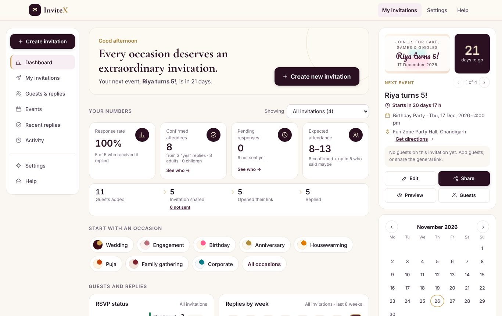

- **Create new invitation** (big button, top) starts a new card.
- **Your numbers:** response rate, confirmed attendees, pending replies and expected attendance. Use **Showing** to see one invitation or all of them.
- **The guest journey line:** guests added → invitation shared → opened their link → replied. Tap **not sent** to see who still needs the link.
- **Next event** (right): a countdown, the date and place, and **Edit**, **Share**, **Preview** and **Guests** buttons. Use the arrows to move between events.
- **Calendar:** every event day is marked.
- **Start with an occasion:** tap Wedding, Birthday, Puja and so on to start a card with that occasion already chosen.

Scroll down for charts of RSVP status and replies by week, your list of invitations (filter by All, Published, Drafts or Upcoming and search by name, venue or occasion), recent replies and activity.

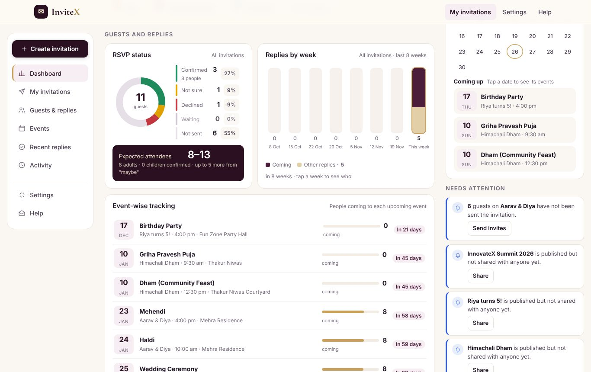

**First time with no invitations?** Tap **Load sample invitations** to add four finished samples (a wedding, a birthday, a Himachali Dham and a conference) and look around.

---

## 3. Make an invitation in five steps

Tap **Create new invitation**. The editor has five steps along the top:

**1 Design → 2 Personalise → 3 Style → 4 Preview → 5 Share**

- The **live preview** on the right shows the card exactly as guests will see it. Above it, switch **Mobile / Desktop**, zoom in or out, open it full screen (⤢), and jump between the four pages: **Cover, Invitation, Events, RSVP**.
- Until you type your own details, the preview shows sample names and dates (a yellow note says so). Sample details are never saved.
- **Your work saves by itself.** "Saved" appears next to **Save draft** at the bottom. The ↶ and ↷ buttons at the top undo and redo.
- Steps 3 and 4 are optional. **Skip to Share →** jumps straight to step 5.
- **Back** and **Next** are in the bar at the bottom.

### Step 1, Design

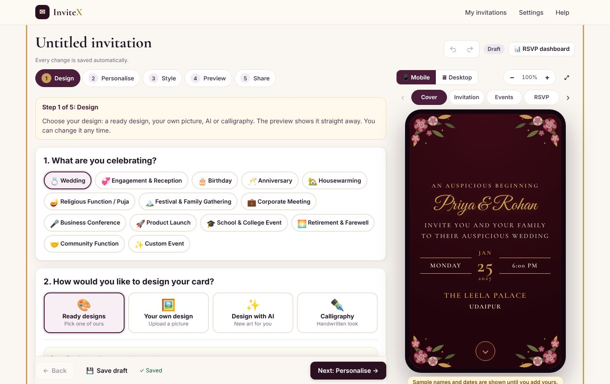

**1. What are you celebrating?** Tap your occasion: Wedding, Engagement & Reception, Birthday, Anniversary, Housewarming, Religious Function / Puja, Festival & Family Gathering, Corporate Meeting, Business Conference, Product Launch, School & College Event, Retirement & Farewell, Community Function or Custom Event.

**2. How would you like to design your card?** There are four ways.

#### Way 1: Ready designs

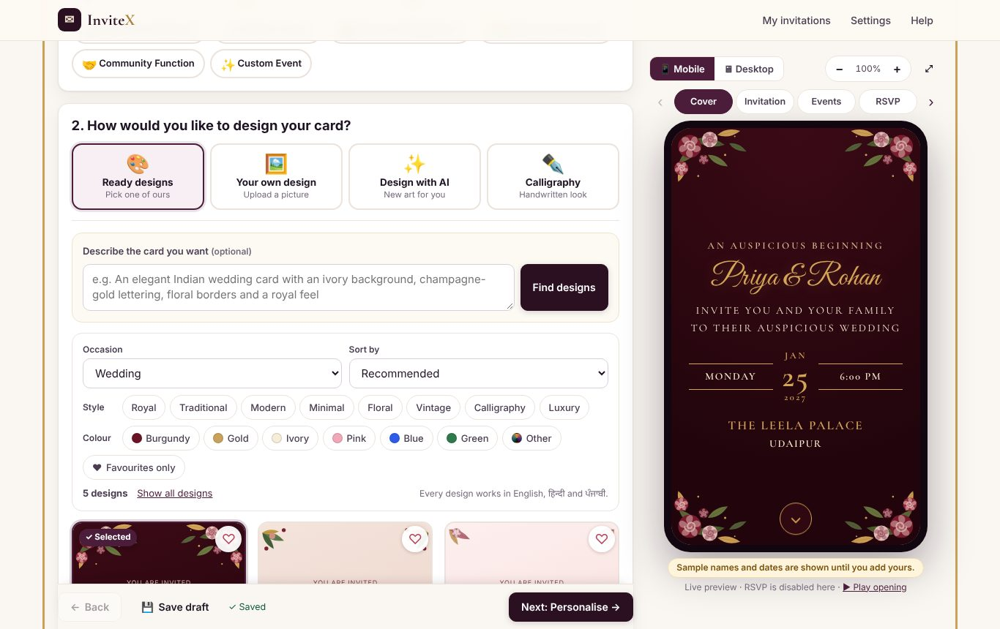

1. **Describe the card you want** (optional). Type a few words, for example "ivory and gold, floral, modern", and tap **Find designs**.
2. Or filter: choose the **Occasion**, then tap a **Style** (Royal, Traditional, Modern, Minimal, Floral, Vintage, Calligraphy, Luxury) and a **Colour** (Burgundy, Gold, Ivory, Pink, Blue, Green and more). **Sort by** Recommended, Favourites first and others.
3. Tap a design to use it. The preview changes straight away.
4. On each design card:
   - ♡ saves it to your **Favourites**. Tick **Favourites only** to see just those.
   - **Quick look** opens it large, with your names, without choosing it.
   - **Compare** adds it to a side-by-side comparison. Pick two or three and open **Compare designs** to see them next to each other with their colours and fonts, then tap **Use this one**.

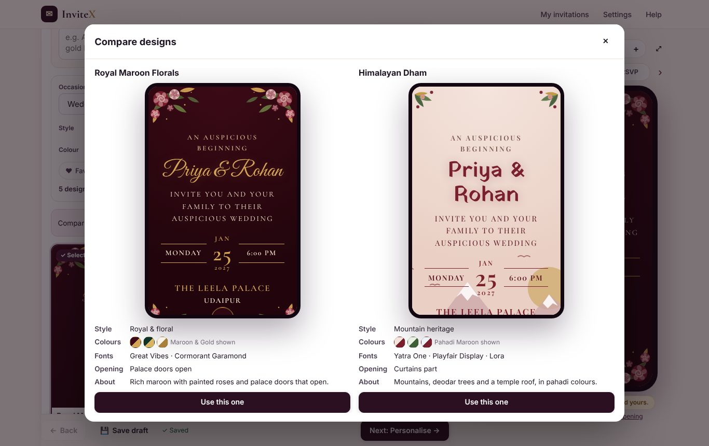

If no design matches your filters, tap **Show all designs**.

#### Way 2: Your own design

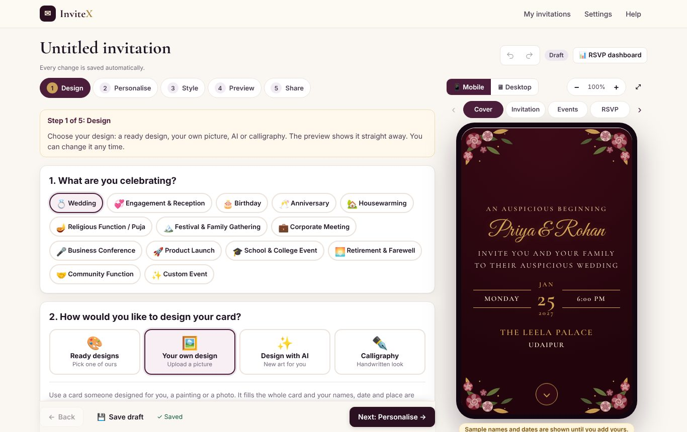

Upload a card someone made for you, a painting or a photo (JPG, PNG or WebP). It fills the whole card and your names, date and place are written on top. Choose **Full picture** or a softer look so the words are easy to read.

#### Way 3: Design with AI

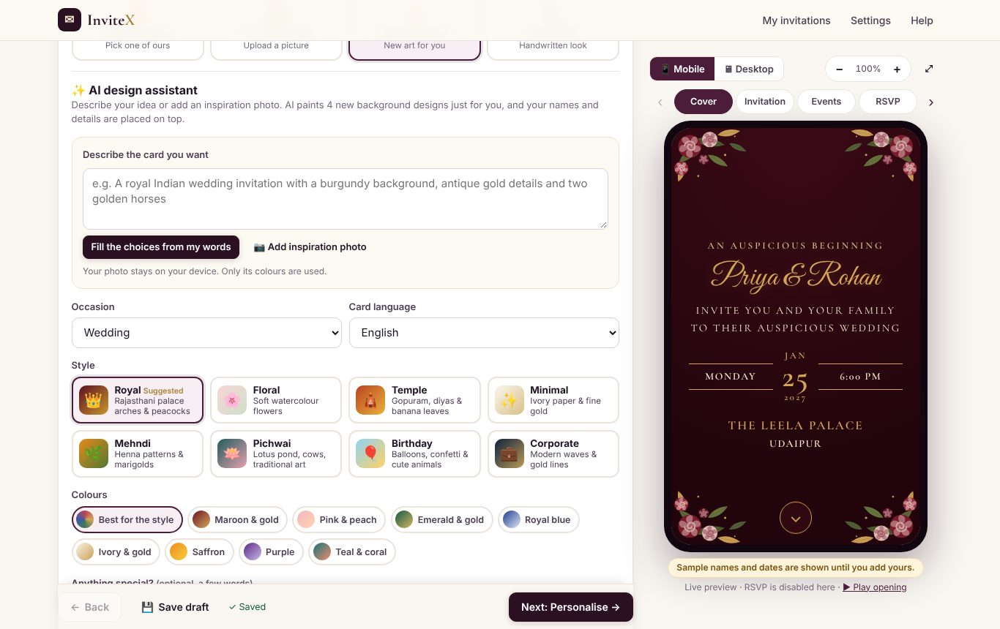

The **AI design assistant** paints four brand-new background designs just for you. Your names and details are placed on top.

1. **Describe the card you want**, for example "a royal Indian wedding invitation with a burgundy background, antique gold details and two golden horses". Tap **Fill the choices from my words** and InviteX picks the matching style and colours for you.
2. Optional: **Add inspiration photo**. Only its colours are used, and the photo stays on your device.
3. Check the **Occasion**, **Card language**, **Style** (Royal, Floral, Temple, Minimal, Mehndi, Pichwai, Birthday, Corporate) and **Colours**. Add anything special in a few words.
4. Tap **Paint 4 designs**. Wait about half a minute, then tap the one you like.

Each account gets a few free tries (the badge shows how many are left). A try that fails is not counted.

#### Way 4: Calligraphy

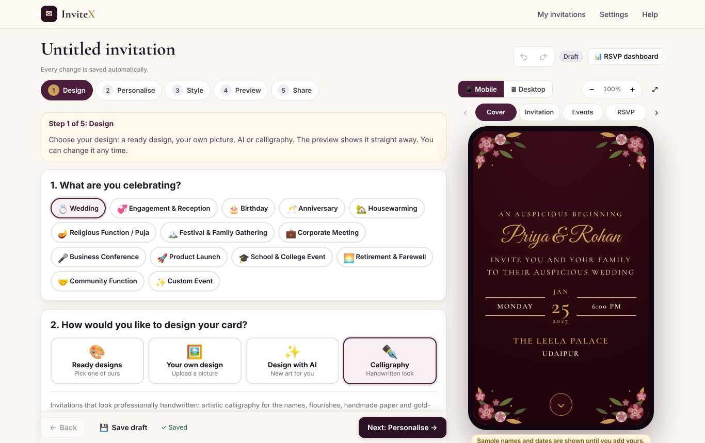

A card that looks professionally handwritten, with flourishes and paper texture. Pick one of the ten styles and **Calligraphy Studio** opens. See [section 4](#4-calligraphy-studio).

When you are happy, tap **Next: Personalise →**.

### Step 2, Personalise

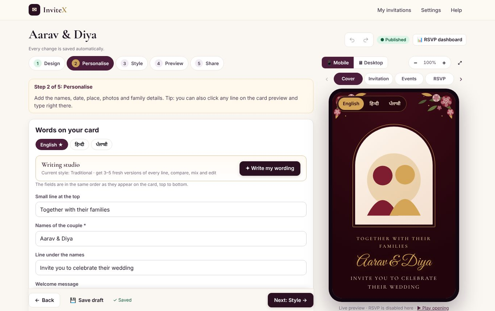

1. **Words on your card.** Fill the lines from top to bottom: the small top line, names, the line under the names and the welcome message. Use the **English / हिन्दी / ਪੰਜਾਬੀ** tabs to write each language.
   *Tip:* you can also click any line on the preview and type there.
2. **Date & place.** Add each event's name, date, start and end time, venue name and address. Guests automatically get a **Get directions** button that opens Google Maps. Add more events, such as Mehendi, Haldi and Reception, with **+ Add event**.
3. **More details** (optional): card languages, country and time zone, dress code, and the contact person guests can call or WhatsApp.
4. **Folded panels** (optional): **Photos, logo & music** (couple or family photos, gallery, logo, background music, voice message or video), **Main invitation message**, and the family details.

#### Need help with the words? Use the writing studio

Tap **✦ Write my wording**.

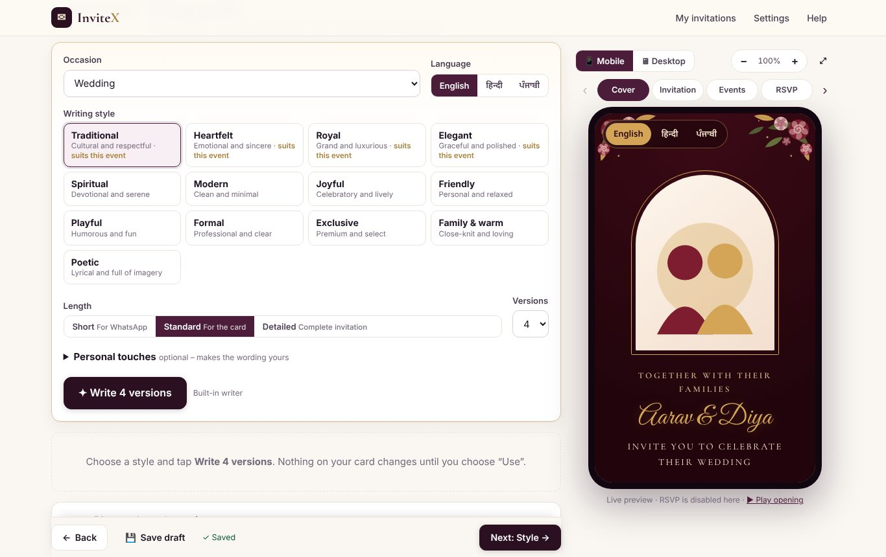

1. Pick a **Writing style**: Traditional, Heartfelt, Royal, Elegant, Spiritual, Modern, Joyful, Friendly, Playful, Formal, Exclusive, Family & warm or **Poetic** (lyrical and full of imagery).
2. Pick a **Length**: Short for WhatsApp, Standard, or Detailed.
3. Add **Personal touches** if you like (how you met, a family saying).
4. Tap **Write 4 versions**. Full versions appear side by side.

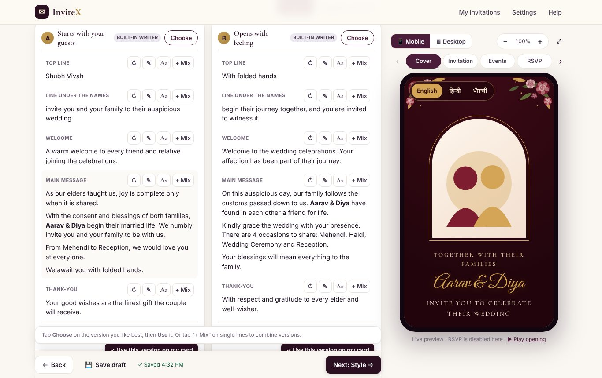

On any line: **↻** gives a new wording, **✎** lets you edit it, **Aa** makes it shorter, longer, more emotional, more formal or more personal, or proofreads it, and **+ Mix** takes that one line into your own mix.

Tap **Choose** on the version you like, then **Use this version on my card**. Nothing on your card changes until you press it, and **↶ Undo last change** brings your old words back.

Tap **Next: Style →**.

### Step 3, Style

*Optional. Skip it if you like the design as it is.*

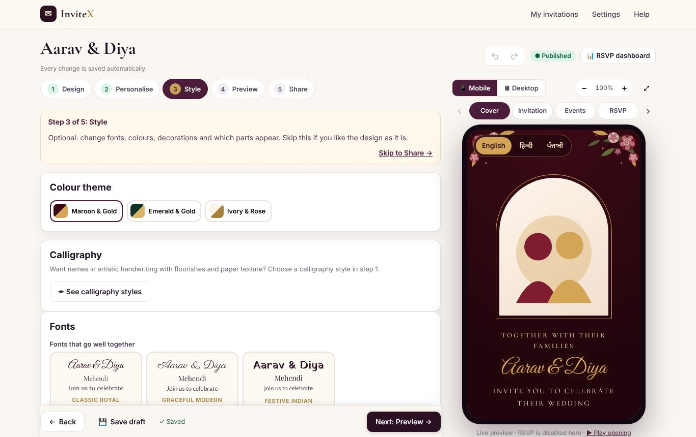

- **Colour theme:** each design comes in several colour sets. Tap one.
- **Calligraphy:** open Calligraphy Studio, or see the calligraphy styles.
- **Fonts:** pairs of fonts that go well together, shown on your own names.
- **Colours, decorations and sections:** fine-tune colours, and choose which parts of the card appear (countdown, schedule, venue, gallery and so on) and in what order.

### Step 4, Preview

*Optional, but worth a look before you send.*

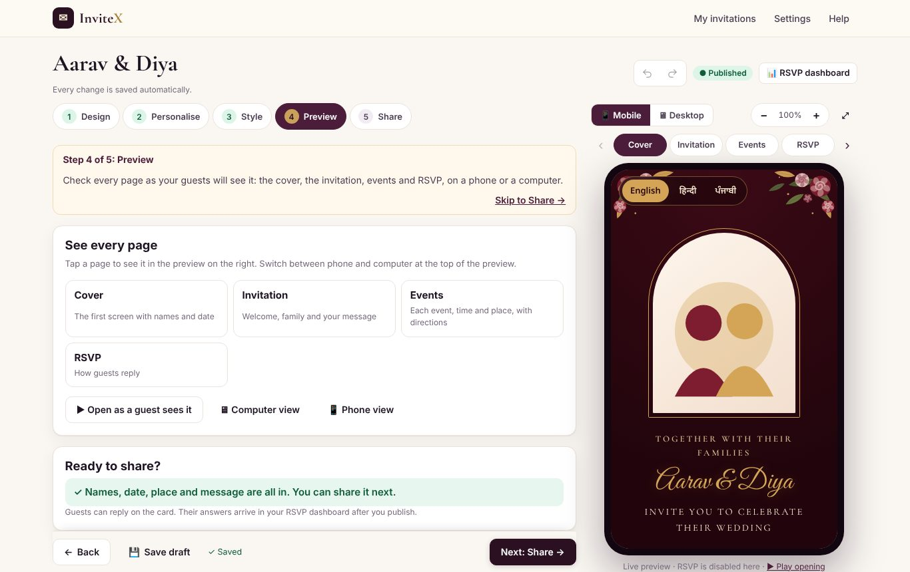

1. **See every page:** tap **Cover**, **Invitation**, **Events** or **RSVP** and the preview jumps there.
2. **▶ Open as a guest sees it** plays the opening animation full screen. **Computer view** and **Phone view** switch the preview size.
3. **Ready to share?** A green tick means names, date, place and message are all in. Anything missing is listed with a button back to step 2.

### Step 5, Share

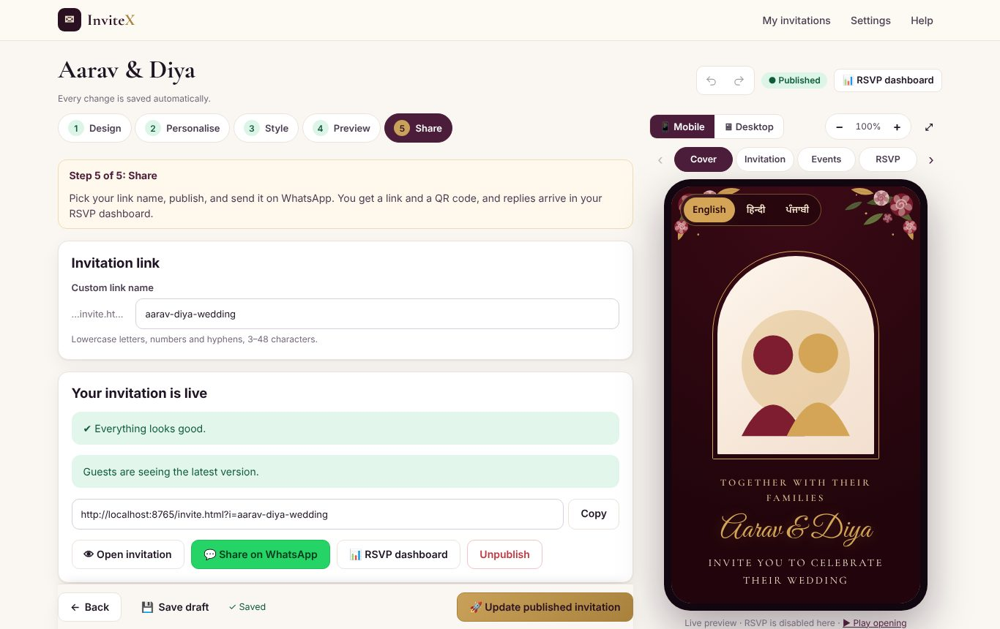

1. **Custom link name**, for example `aarav-diya-wedding`. Use lowercase letters, numbers and hyphens. InviteX tells you straight away if the name is taken.
2. Read **Ready to publish?**. A red line must be fixed first (no title, no date or no link name). A yellow line is only a friendly warning.
3. Tap **🚀 Publish invitation**. Your link appears with **Copy**, **👁 Open invitation**, **💬 Share on WhatsApp** and **📊 RSVP dashboard**.
4. **More options** (optional): RSVP deadline, maximum total guests, maximum people per invitation, ask about children, food or which events, offer guests a WhatsApp reply button, a password, and an expiry date.

**Changing a live invitation.** Edit anything, then tap **Update published invitation**. Until you press it, guests keep seeing the old version, so you can edit calmly. **Unpublish** takes the link offline.

---

## 4. Calligraphy Studio

Calligraphy Studio is a full-screen editor for handwritten-style cards. Every change shows on the card at once and is saved by itself.

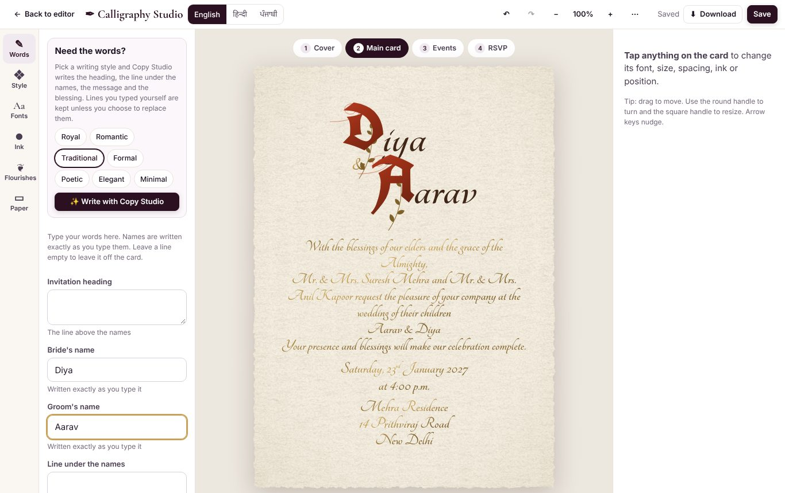

**The left-hand tools**

- **Words:** heading, bride's and groom's names, the line under the names, parents, date, time, venue, reception, message, RSVP details and blessings. Names are written exactly as you type them. Leave a line empty to leave it off the card.
  **Need the words?** Pick a writing style (Royal, Romantic, Traditional, Formal, Poetic, Elegant, Minimal) or tap **✨ Write with Copy Studio**.
- **Style:** ten starting styles, from Royal English Calligraphy to Luxury Black Ink. Changing style keeps your words. Choose how the names sit (stacked, staggered, side by side or arched) and the card size (5 × 7 in or A5).
- **Fonts:** 33 calligraphy fonts in groups, plus Hindi and Punjabi fonts. Tap a line on the card first, then pick its font.
- **Ink:** a separate ink for each name, the initials, heading, message, details and flourishes. Gold, bronze and copper shimmer on screen.
- **Flourishes:** tap one to add it. Drag to move, square handle to resize, round handle to turn.
- **Paper:** eight papers (handmade ivory, parchment, cotton rag and more), your own colour, texture, torn edges, border and corners.

**Four matching pages:** the buttons above the card switch between **Cover**, **Main card**, **Events** and **RSVP** (with a QR code once the invitation is published).

**Tap anything on the card** to change its font, size, spacing, ink or position on the right. Undo and redo are at the top (Ctrl+Z and Ctrl+Y on a computer). **Back to editor** returns to the five steps.

### Download and print

Tap **⬇ Download** (top bar, or **✒ Download calligraphy card** on the invitation's dashboard).

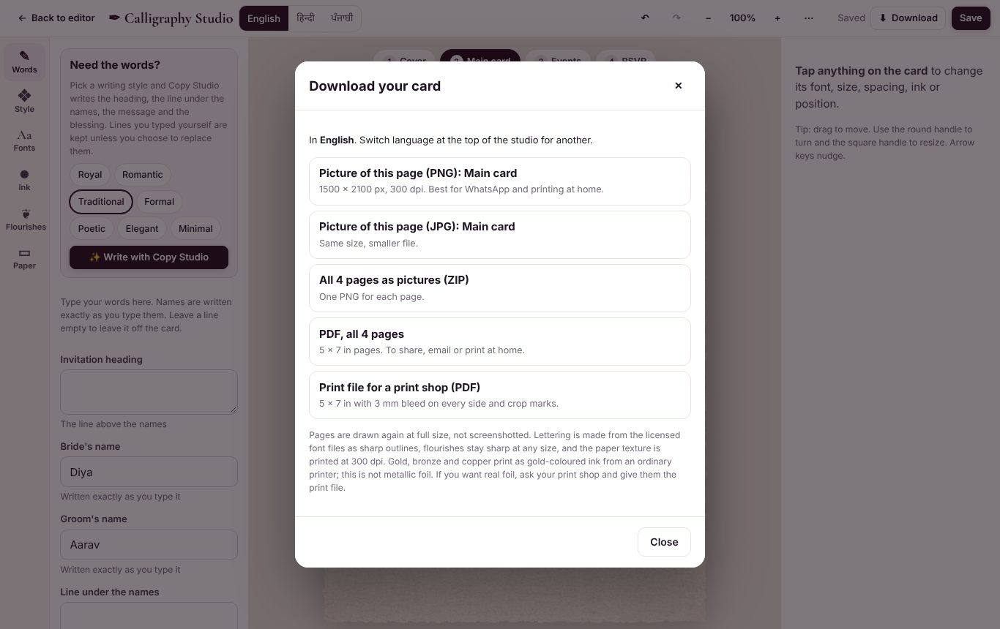

| Choice | Best for |
| --- | --- |
| Picture of this page (PNG) | WhatsApp and printing at home. 1500 × 2100 px, 300 dpi |
| Picture of this page (JPG) | The same, as a smaller file |
| All 4 pages as pictures (ZIP) | One PNG per page |
| PDF, all 4 pages | Sharing by email or printing at home |
| Print file for a print shop (PDF) | Giving to a printer. Has 3 mm bleed and crop marks |

Gold, bronze and copper print as a gold-coloured ink on an ordinary printer, not as metallic foil. For real foil, ask your print shop and give them the print file. Add your names first: downloads never include the faint sample names.

---

## 5. Send it to your guests

Open the invitation's **RSVP dashboard** (from step 5, or **Guests** on the home screen).

### Start sharing

The first time you open the **Share** tab you see **Start sharing**. Everything before this (design, photos, preview, guest list, messages) is free.

- **Today, sharing is free.** Tap **Start sharing** and the sharing buttons appear.
- **Coming soon: paid sharing.** When it is switched on, the button will show a small one-time price for the whole campaign, for example **Start sharing · Pay ₹20 by UPI**. One payment will cover every guest on the list, and resending, reminders and new guests in that campaign stay free. You pay with any UPI app (scan a QR code on a computer, or pick your UPI app on a phone). Paid sharing is not live yet.

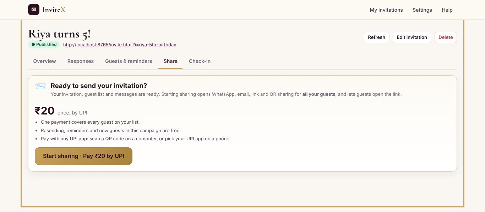

### Add your guest list

**Guests & reminders** tab:

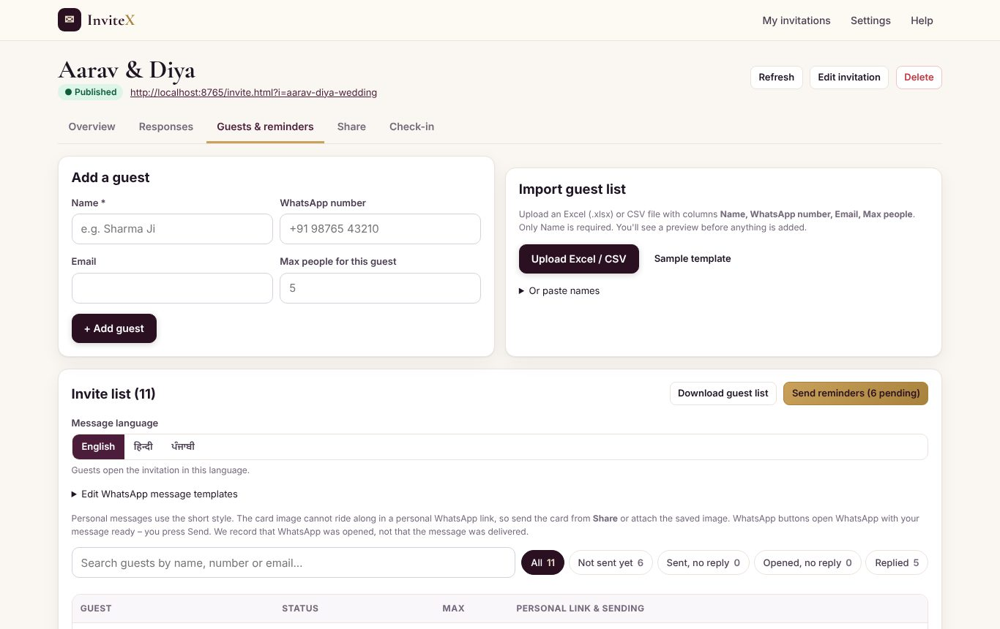

- **Add a guest:** name, WhatsApp number, email (optional) and the most people for this guest. Tap **+ Add guest**.
- **Import a list:** tap **Upload Excel / CSV** (download the **Sample template** first), or **Or paste names**. You see a preview before anything is added.
- Each guest gets a **personal link** that greets them by name and remembers their number, so replying is one tap.
- Tap **WhatsApp** next to a guest. WhatsApp opens with the message ready. **You press Send.**
- Filter the list by **Not sent yet**, **Sent, no reply**, **Opened, no reply** and **Replied**. **Send reminders** messages everyone who has not replied.

### Share one general link

**Share** tab:

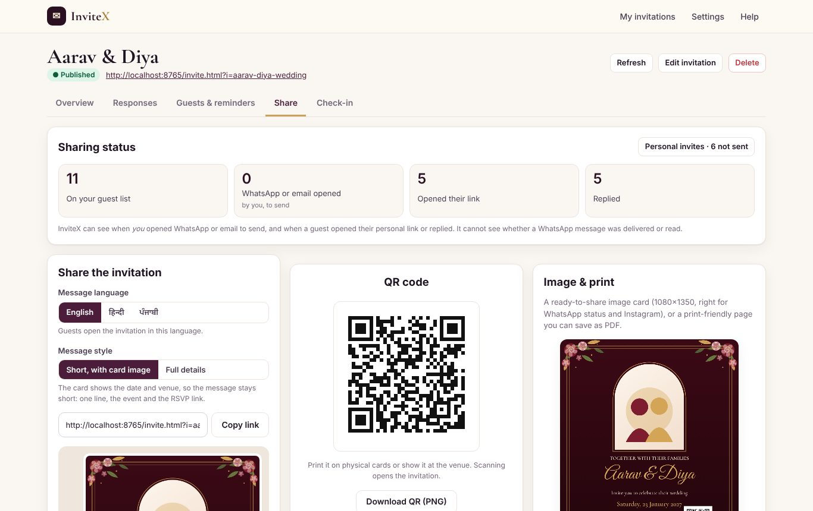

- **Message language** and **Message style**: **Short, with card image** (the card picture, one line and the RSVP link) or **Full details** (date, time and venue in the message).
- **Copy link** to paste anywhere.
- **QR code:** download it to print on paper cards or show at the venue.
- **Image & print:** a ready-to-share card picture (1080 × 1350) for WhatsApp status and Instagram, or a print-friendly page.

**Sharing status** at the top shows who is on your list, whose WhatsApp or email you opened, who opened their link and who replied. InviteX never claims a WhatsApp message was "delivered", because it cannot know that.

---

## 6. What your guests see

Guests don't sign up or install anything. They tap your link, usually in WhatsApp.

| 1. Opening | 2. The card | 3. Events |
| --- | --- | --- |
| 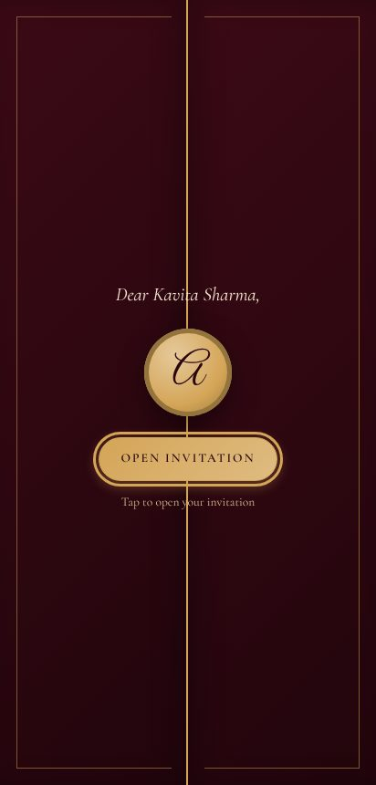 | 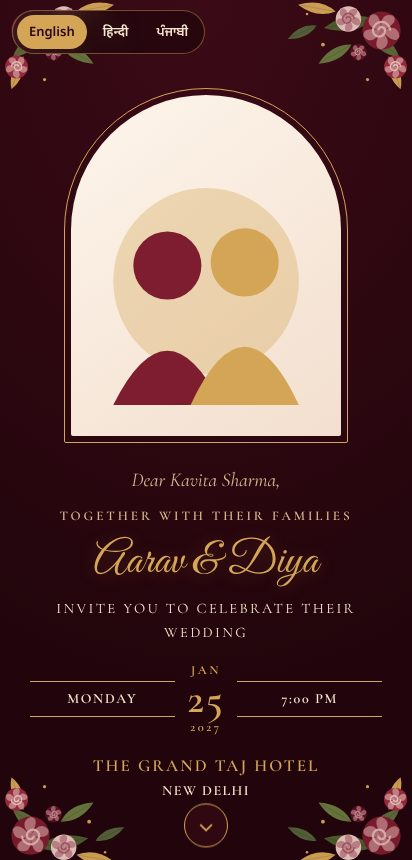 | 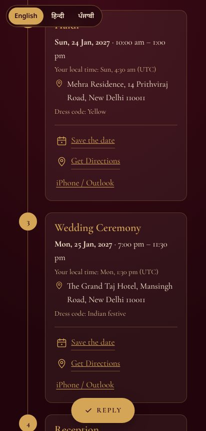 |

1. The card opens with a short animation, greeting them by name on a personal link. They tap **Open Invitation**.
2. They scroll through names, message, countdown, events, venue and photos. They can switch language at the top and pause music.
3. Each event has **Save the date** (Google Calendar, or iPhone / Outlook) and **Get directions** (Google Maps).

| 4. One-tap reply | 5. Thank you | In Hindi |
| --- | --- | --- |
| 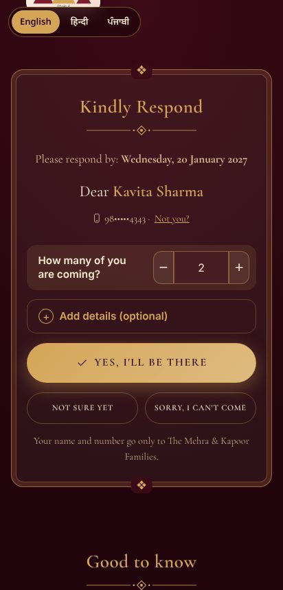 | 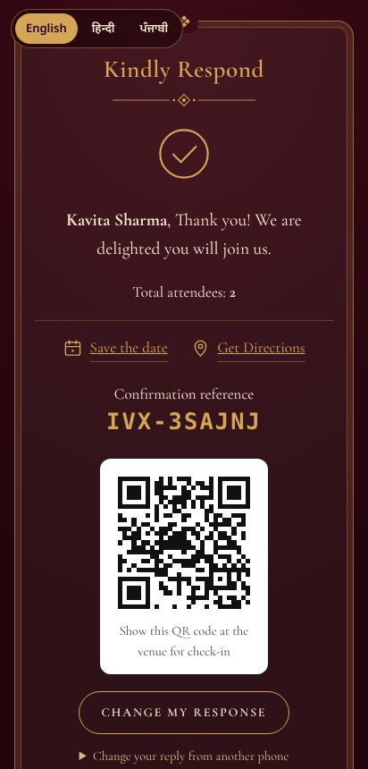 | 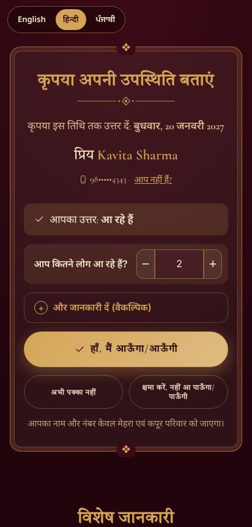 |

4. To reply they set how many people are coming and tap **Yes, I'll be there**, **Not sure yet** or **Sorry, I can't come**. On a personal link their name and number are already filled in, so it is one tap. **Add details (optional)** asks about children, events, food and a message for you. On a phone a floating **Reply** button is always in reach.
5. After replying they see a thank-you, a **confirmation reference** (for example IVX-C5VUJQ), a **QR code** for check-in at the venue, and **Change my response**.

The whole guest page works in English, हिन्दी and ਪੰਜਾਬੀ.

---

## 7. Track replies

The **RSVP dashboard** for each invitation has five tabs. It refreshes every 30 seconds.

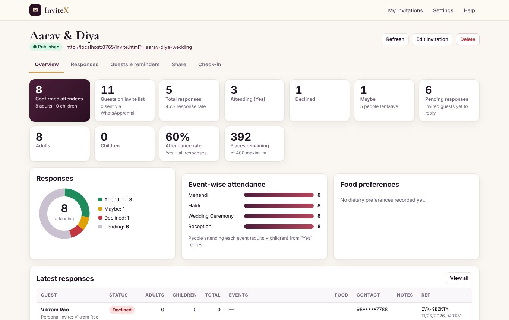

| Tab | What you do there |
| --- | --- |
| **Overview** | Confirmed attendees (adults and children), guests on the list, total responses, attending, declined, maybe, pending, attendance rate, places remaining, event-wise attendance and food preferences |
| **Responses** | Search and filter replies, edit a reply, **+ Add response manually** (for phone-call replies), **Export CSV / Excel**, **Print list** |
| **Guests & reminders** | Add or import guests, filter by sending status, **Send reminders** |
| **Share** | General link, WhatsApp message, QR code, card image, print |
| **Check-in** | Scan guests in on the day |

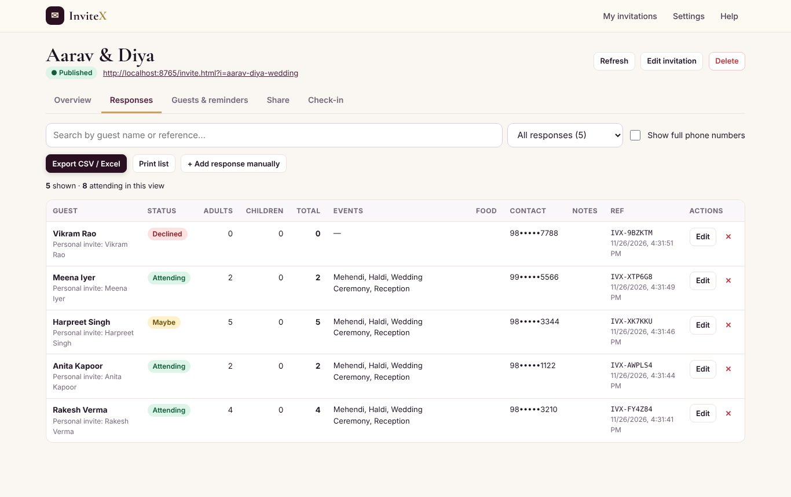

"Not sure" and "Can't come" replies are never counted as confirmed attendees.

**Other actions:** **Edit invitation** goes back to the five steps. **Duplicate** (from the invitation list) copies an invitation as a new draft without guests or replies. **Delete** permanently removes the invitation with its guests, replies and photos.

---

## 8. On the day: check-in

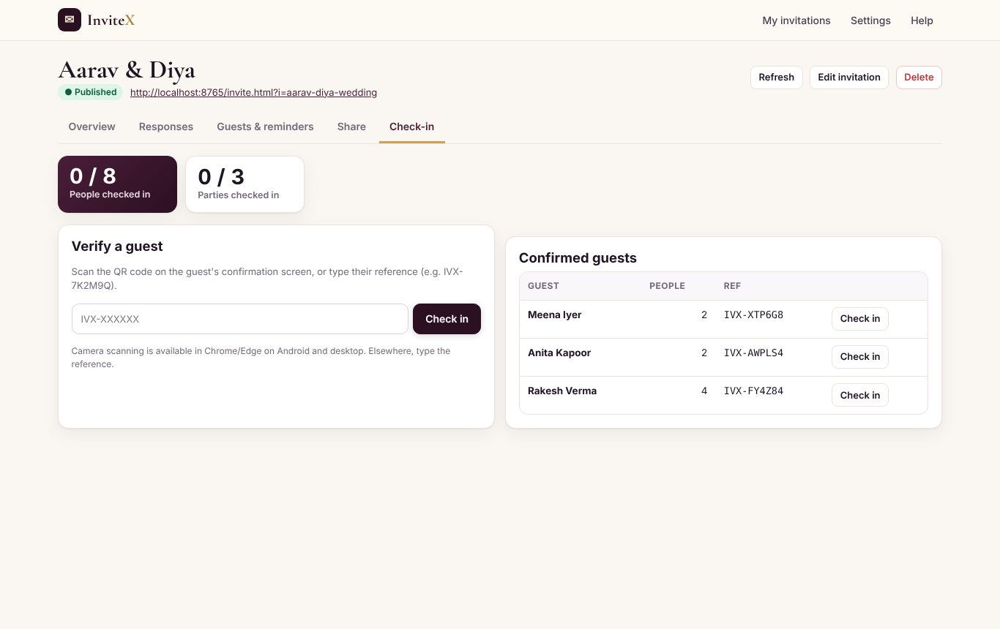

Open the **Check-in** tab on a phone at the entrance. Scan the QR code on the guest's thank-you screen with the camera, or type their reference (for example IVX-7K2M9Q). The counters at the top show people and parties checked in. The **Confirmed guests** list lets you tap **Check in** by name.

---

## 9. Settings

Settings are the starting values for every **new** invitation. Invitations you already made keep their own. Your choices follow you to any phone or computer you sign in on.

| Tab | What it holds |
| --- | --- |
| **Account** | Your name and WhatsApp number (the contact on new invitations), backup and restore, and **Sign out** |
| **Language** | Which languages new invitations use, and the main one |
| **WhatsApp** | The default message style (short with card image, or full details) and language, with a preview of the message |
| **Plan** | How sharing is priced, your sharing campaigns and your payments |

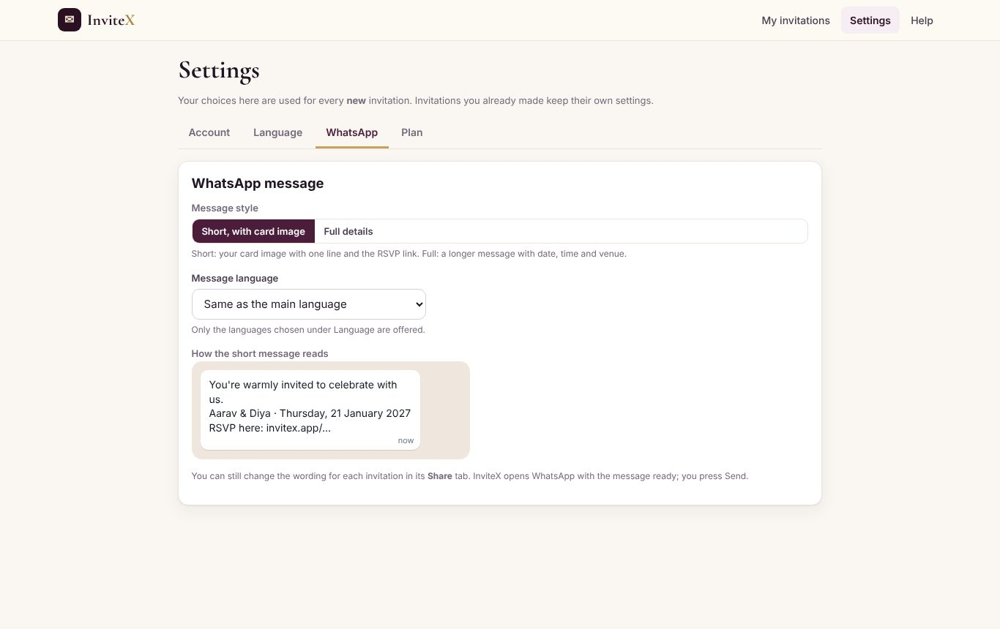

---

## 10. Using InviteX on a phone

Everything works on a phone. The five steps sit in a row at the top, the preview opens from the 👁 button in the bottom bar, and **Next** is always at the bottom right.

| Home | Editor |
| --- | --- |
| 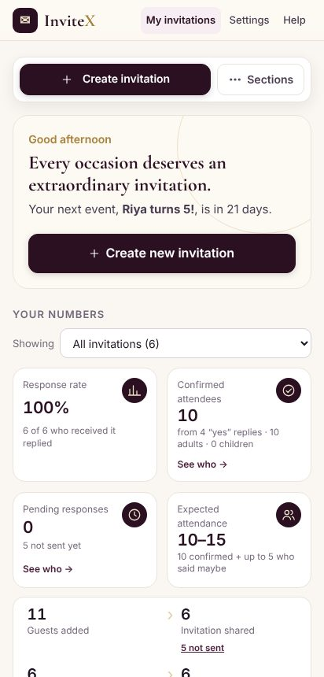 | 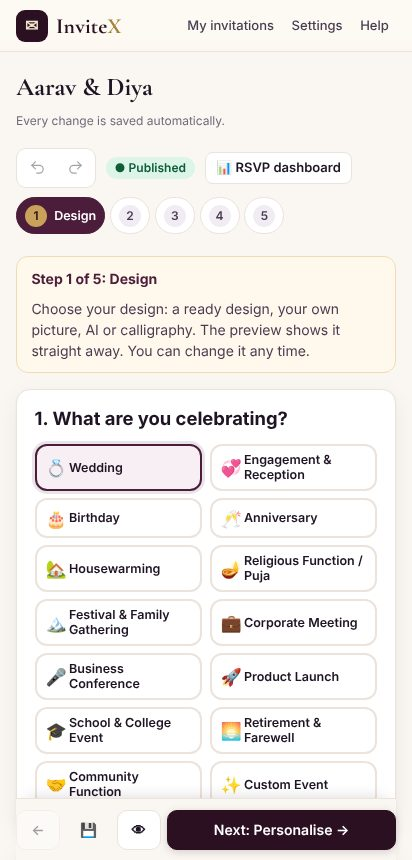 |

---

## 11. Questions and fixes

**I didn't get the confirmation or sign-in email.** Check spam. Wait a minute and try again.

**Guests say the link doesn't open.** Check the invitation shows **Published** (green), has not expired, and that you have tapped **Start sharing**. If you set a password, guests need it.

**I changed the card but guests see the old one.** Go to step 5 and tap **Update published invitation**.

**A guest replied twice.** If they use the same mobile number, InviteX asks them to change their first reply instead, so there are no duplicates.

**Does InviteX send WhatsApp messages for me?** No. It opens WhatsApp with the message ready, and you press Send. This keeps your messages coming from your own number.

**Can two people manage one event?** Not yet from separate accounts. Today, share one login.

**Can I print the card?** Yes. Use the calligraphy downloads, or **Image & print** on the Share tab.
