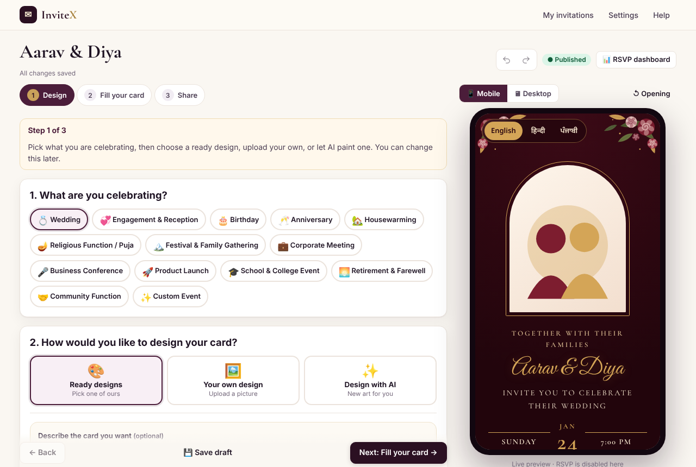
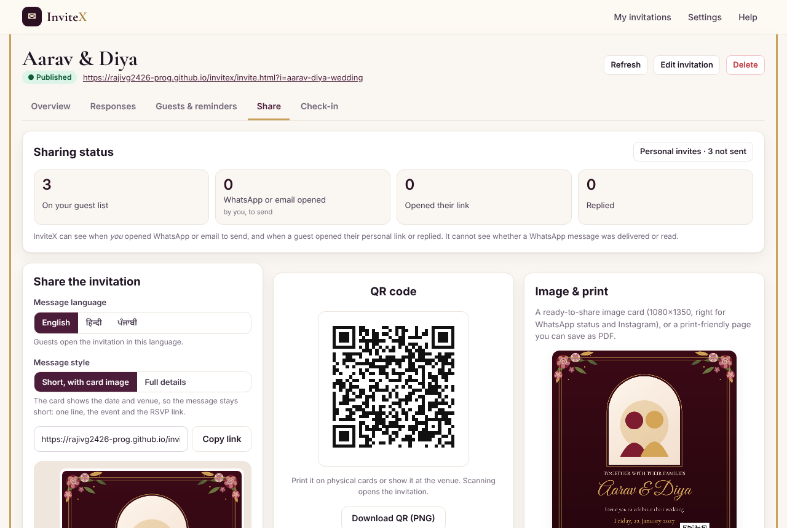
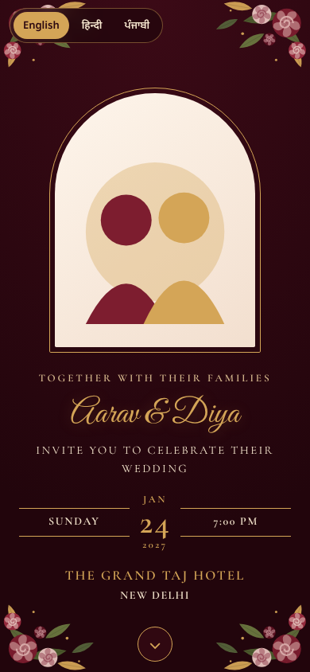
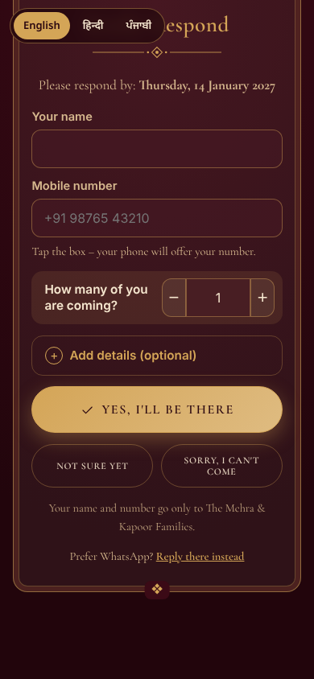
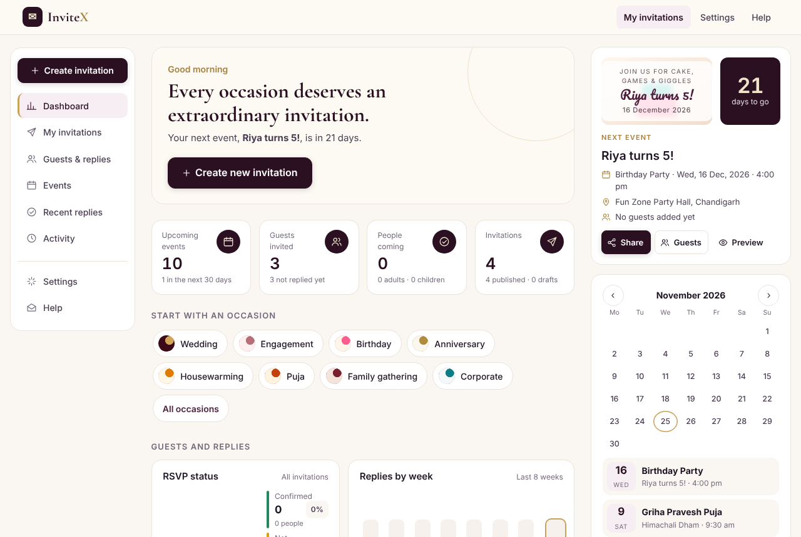

# InviteX User Manual and Admin Guide

InviteX lets a host make a digital invitation in three steps (Design, Fill your card, Share), send it on WhatsApp, and track who is coming. Guests never need an account; they open a link and reply with one tap.

This manual is for hosts and for whoever runs InviteX for a team. **Part 1** walks through the app step by step. **Part 2** explains how several people use it. **Part 3** explains the in-app Admin page: how to switch it on, make yourself admin, and use it.

- **App address:** https://rajivg2426-prog.github.io/invitex/
- **Works on:** phone or computer, in any modern browser. No app to install.
- **Languages on the card:** English, हिन्दी and ਪੰਜਾਬੀ.

---

# Part 1. Using InviteX

## Step 1: Create your account and sign in

Every host signs in with their own email. It takes about a minute the first time.

**Create an account**

1. Open the app address. The **Host sign in** screen opens by itself.
2. Type your email and a password of at least 8 characters.
3. Tap **Create account**.
4. Open the email InviteX sends you and tap the confirmation link. You are now signed in.

**Sign in next time**

- With a password: type your email and password and tap **Sign in**.
- Without a password: type only your email, leave the password empty, and tap **Sign in**. You get a one-time sign-in link by email. Tap it and you are in.

**Sign out:** go to **Settings → Account** and tap **Sign out**.

If the top of the screen shows a yellow **Demo · Local** strip, you are on a copy that is not connected to the online database. Anything you make there stays in that one browser, and guests cannot reply from their phones. The live address above is connected.

## Step 2: Make an invitation in 3 steps

On the home screen, tap **Create new invitation**, or tap an occasion such as **Wedding** or **Birthday** to start with it picked. The editor has three steps along the top: **1 Design**, **2 Fill your card**, **3 Share**. The live preview on the right (or **Preview** on a phone) shows the card exactly as guests will see it.

Your work saves by itself ("All changes saved" under the title). The ↶ and ↷ buttons undo and redo any change.

### 2.1 Design

1. **What are you celebrating?** Tap the occasion (14 choices, from Wedding to Community Function).
2. **How would you like to design your card?** Pick one of three ways:
   - **Ready designs**: tap a design, then one of its colour dots. Designs are grouped by occasion, and the best one for your event is marked. Not sure? Type a few words in **Describe the card you want** (for example "royal maroon and gold") and InviteX shows the closest matches.
   - **Your own design**: upload a card someone made for you, a painting or a photo (JPG, PNG or WebP). It fills the whole card and your names, date and place are written on top. Choose **Full picture** or a softer look.
   - **Design with AI**: pick a style (Royal, Floral, Temple, Minimal, Mehndi, Pichwai, Birthday or Corporate) and colours, then tap **Paint 4 designs**. Wait about half a minute and tap the one you like. Each account gets 3 free tries; a try that fails is not counted.
3. **Colours & shape**: fine-tune colours and pick **Portrait** (best for WhatsApp), landscape or square.
4. Tap **Next: Fill your card**.



### 2.2 Fill your card

1. **Words on your card**: fill in the lines from top to bottom (small top line, names, line under the names, welcome message). Use the **English / हिन्दी / ਪੰਜਾਬੀ** tabs to write each language. Tip: you can also click any line on the card preview and type there.
2. **Want help with the wording?** Tap **✦ Write my wording** to open the Writing studio:
   - Pick a writing style (Traditional, Heartfelt, Royal, Elegant, Spiritual, Modern and more), a length (Short for WhatsApp, Standard, Detailed) and how many versions.
   - Tap **Write versions**. You get 3 to 5 full versions side by side.
   - On any line: **↻** gives a new wording, **✎** lets you edit it, **Aa** makes it Shorter, Longer, More emotional, More formal, More personal, or Proofreads it, and **+ Mix** takes that line into your mix.
   - Tap **Choose** on the version you like, then **Use**. Nothing on your card changes until you press **Use**, and **↶ Undo last change** brings your old wording back.
3. **Date & place**: add the event name, date, start and end time, venue name and address. Guests get a **Get directions** button that opens Google Maps from the address, so you do not need a map link (you can paste one if you prefer). Add more events, such as Mehendi, Haldi and Reception, with **+ Add event**.
4. **More details** (optional): card languages, country and time zone, dress code, and the contact person guests can call or WhatsApp.
5. The folded panels below are optional:
   - **Photos, logo & music**: couple or family photos with names, a photo gallery, logo, background music, voice message or video.
   - **Main invitation message**: the full message, already written in your chosen style. Open it to read or change it.
   - **Fonts, colours & sections**: fonts, colours, and which parts of the card appear and in what order.
6. Tap **Next: Share**.


### 2.3 Share (publish)

1. **Custom link name**: for example `aarav-diya-wedding`. Use lowercase letters, numbers and hyphens. The app tells you if a name is taken.
2. Read the **Ready to publish?** box. A red line must be fixed first (no title, no date, no link name). A yellow line is a friendly warning.
3. Tap **🚀 Publish invitation**. Your link appears with **Copy**, **Open invitation**, **Share on WhatsApp** and **RSVP dashboard** buttons.
4. **More options** (optional): RSVP deadline, maximum total guests, maximum people per invitation, which questions to ask, a password, an expiry date, and the map on or off.

**Changing a live invitation:** edit anything, then tap **Update published invitation**. Until you do, guests keep seeing the old version, so you can edit calmly. **Unpublish** takes the link offline.


### 2.4 Send it to guests

Open the invitation's **RSVP dashboard** (from step 3, or **Guests** on the home screen).

- **Guests & reminders** tab: add guests one by one (name, WhatsApp number, how many people), paste a list, or tap **Upload Excel / CSV** (download the **Sample template** first). You see a preview before anything is added. Each guest gets a personal link that greets them by name. Tap **WhatsApp** next to a guest: WhatsApp opens with the message ready, and **you press Send**.
- **Share** tab: one general link anyone can reply on. Pick the **message language** and **message style**. **Short, with card image** sends the card picture with one line and the RSVP link (on a phone, the share sheet sends both together; on a computer the image is saved and WhatsApp opens with the message ready). **Full details** sends the longer text. You can also download a **QR code**, a **1080×1350 image card** for WhatsApp status or Instagram, or **Print / Save as PDF**.

**Starting sharing.** The first time you open the **Share** tab of an invitation you see **Start sharing**. Until you start, guests who open your link see "This invitation is not open yet". Everything before this (design, photos, preview, guest list, messages) is free.
- If sharing is free right now, tap **Start sharing** and the sharing buttons appear.
- If there is a price, the button says, for example, **Start sharing · Pay ₹20 by UPI**. Razorpay opens with UPI only: scan the QR code on a computer, or pick your UPI app on a phone. When the payment is confirmed, the Share tab shows **Paid ₹20** and the sharing buttons appear.
- One payment covers **all your guests** for this invitation. Adding guests, resending and reminders in the same campaign are free.
- If you close the payment window or UPI is slow, you see **Try again**, **I already paid** and **Not now**. You are never charged twice for one campaign; if it ever happens, the extra payment is refunded.
- When you have finished, **Mark as done**. Links you sent keep working and guests can still reply. You can reopen a finished campaign for free.

InviteX shows honest sharing status: on the list, WhatsApp or email opened by you, link opened, replied. It never claims a WhatsApp message was "delivered", because it cannot know that.




## Step 3: What guests see and how they reply

Guests do not sign up or install anything. They tap your link, usually in WhatsApp.

1. The card opens with a short animation. They tap **Open Invitation**.
2. They scroll through the card: names, message, countdown, schedule, venue, photos. They can switch language at the top and pause music.
3. Under the venue they get **Save the date** (Google Calendar or Apple/Outlook) and **Get directions** (Google Maps).
4. To reply, they type their name and mobile number (on a personal link these are already filled in), set how many people are coming, and tap **Yes, I'll be there**, **Not sure yet** or **Sorry, I can't come**. That is one tap. **Add details (optional)** asks about children, which events, food, other names and a message for you. On a phone a floating **Reply** button is always in reach.
5. After replying they see a thank-you, a **confirmation reference** (for example IVX-7K2M9Q), a **QR code** for check-in at the venue, and **Change my response** to update their answer later.

If someone tries to reply twice with the same mobile number, they are asked to use their own change link instead.

| The card | One-tap reply | After replying |
| --- | --- | --- |
|  |  |  |

## Step 4: Track replies

**Home dashboard** (tap **My invitations**): your next event with a countdown and Share / Guests / Preview buttons; key numbers (upcoming events, guests invited, people coming, invitations); a calendar; **Needs attention** (drafts close to the date, guests not sent or not replied, places running out) with a button for each; and recent replies and activity. Each invitation card has six quick actions: **Edit, Preview, Share, Guests, Analytics, Duplicate**.



**RSVP dashboard** for one invitation has five tabs:

| Tab | What you do there |
| --- | --- |
| Overview | Confirmed attendees, adults and children, yes / no / maybe, pending, response rate, places left, event-wise attendance, food preferences |
| Responses | Search and filter replies, edit a reply, **+ Add response manually** (for phone-call replies), **Export CSV / Excel**, **Print list** |
| Guests & reminders | Add or import guests, filter by Not sent yet / Sent, no reply / Opened, no reply / Replied, and **Send reminders** to everyone pending |
| Share | General link, WhatsApp card message, QR code, image card, print |
| Check-in | On the day, scan a guest's QR code with the camera or type their reference |


"Not sure" and "Can't come" replies are never counted as confirmed attendees. The dashboard refreshes every 30 seconds and when you come back to the tab.

**Other actions:** **Duplicate** copies an invitation as a new draft without guests or replies. **Delete** (top of the RSVP dashboard) permanently removes the invitation, its guests, replies and uploaded files.

## Step 5: Settings

Settings apply to every **new** invitation. Invitations you already made keep their own settings. Your choices are saved on your account, so they follow you to any phone or computer you sign in on.

| Tab | What it holds |
| --- | --- |
| Account | Your name and WhatsApp number (used as the contact on new invitations), the data mode, and **Sign out** |
| Language | Which languages new invitations use, and the main one |
| WhatsApp | Default message style (short with card image, or full details) and language |
| Plan | How sharing is priced right now, your sharing campaigns, and your payments (with a TEST label for test payments) |

---

# Part 2. Multiple users: how a team uses InviteX

Any number of people can use InviteX at the same time, each with their own account. Each account is fully private: a host sees and edits only the invitations they created, and their guest lists and replies. The database enforces this (Row Level Security on `owner_id`), not just the screens, so one host cannot open another host's data even by guessing a link.

**To add a person to InviteX**

1. Send them the app address.
2. They tap **Create account** with their own email and a password, then confirm the email.
3. They sign in and start making invitations. Nothing else is needed.

| Who | What they can do today |
| --- | --- |
| Host (any signed-in account) | Create, edit, publish, share and delete their own invitations; manage their own guests and replies; their own settings |
| Another host | Cannot see or change your invitations, guests or replies |
| Guest | Opens a published link, replies, changes their own reply. No account needed. Never sees other guests' phone numbers |
| Admin (an account marked admin) | Everything a host can do, plus the **Admin** page: see every account and invitation, pause accounts, unpublish or delete invitations, give AI tries, see usage and the activity log (see Part 3) |
| Supabase project owner | Everything, through the Supabase dashboard (see Part 3) |

**What does not exist yet:** there are no teams, shared workspaces or co-hosts. Two people cannot both edit the same invitation from their own accounts. If two family members or two staff need to manage one event, today they must share one login. That works, but everyone on that login sees everything on it, and you cannot tell who changed what.

---

# Part 3. Admin control

InviteX has an **Admin page** inside the app. Only accounts marked **admin** can open it; everyone else is a normal **host** and sees only their own invitations. An admin's own "My invitations" page still shows only their own invitations: the Admin page is a separate place.

The protection is in the database, not just the screen. A host who types the Admin address, or calls the admin functions directly, is refused by the database. The app never uses the Supabase secret (service) key.

## 3.1 Switch it on (one time, about 5 minutes)

You do this once, in the **Supabase dashboard** (supabase.com) for the InviteX project.

**Step 1. Add the admin part to the database.**
1. Open your project, then **SQL Editor** → **New query**.
2. Open the file [`supabase/admin.sql`](../supabase/admin.sql) from the InviteX code, copy all of it, and paste it in.
3. Press **Run**. You should see "Success. No rows returned". It is safe to run again later.

This adds a role (admin or host) and a status (active or paused) to every account, the admin-only functions, the rules that lock out paused accounts, and the activity log. Existing accounts all start as active hosts.

**Step 2. Make yourself the first admin.**
You must have signed in to InviteX at least once with this email. In a new SQL Editor query, put in your own email and press **Run**:

```sql
update public.profiles set role = 'admin'
 where user_id = (select id from auth.users where email = 'you@example.com');
```

It should say "1 row affected". If it says 0, check the spelling of the email under **Authentication → Users**.

**Step 3. Open the Admin page.**
Reload InviteX (or sign out and in). An **Admin** link appears in the top menu, next to Settings. On the home dashboard it is also in the left menu.

After this, you never need SQL for roles: make other people admin from the Admin page itself.

## 3.2 The Admin page

The left menu has Users, Invitations, Usage analytics and Audit log, plus the money screens in 3.2b. On a phone they appear as tabs across the top.

**Users** lists every account: email, when they joined and last signed in, how many invitations (and how many are live), replies received, and AI tries used out of their allowance. Search by email. Press **Manage** on an account to:

| Action | What happens |
| --- | --- |
| **Add tries** | Adds AI design tries to their allowance (1 to 1000). Add a note such as "bought a pack". One try paints up to 4 designs. |
| **Pause account** | They can no longer open, change or create invitations, or use AI tries. When they sign in they see "Your account is paused" with the reason you type. Their guests' replies are kept. Tick **Also take their published invitations offline** to unpublish everything they have live at the same time. |
| **Re-activate** | Undoes a pause. Invitations that were taken offline stay as drafts until they publish them again. |
| **Make admin / Remove admin** | Gives or removes the whole Admin page. You are asked to confirm before making someone admin. |

You cannot pause yourself or change your own role, so you can never lock yourself out. Another admin has to do that.

**Invitations** lists every invitation from every account, with its owner, status, guests, replies and people coming. Filter by All, Published or Drafts, or search by title, link name or owner email.
- **Open** shows the guest view of a published invitation.
- **Unpublish** turns it back into a draft. Guests who open the link see that it is not available. The owner can publish it again.
- **Delete** removes it for good, with its guest list, replies and uploaded photos. The owner is not told. This cannot be undone.

Both ask for a reason, which goes in the activity log.

**Usage** shows totals (accounts, invitations, replies, people coming, AI designs with an estimated cost in rupees) and a week-by-week table for the last 8 weeks: new accounts, invitations made, published, replies and AI designs. It also lists the five accounts that used the most AI designs. The cost is an estimate (about ₹3.5 per Google image, ₹5 per OpenAI image); your Google or OpenAI bill is the real figure.

**Activity log** records every change made on the Admin page: what was done, to whom, by which admin, when, and the reason or note. Filter by Accounts or Invitations. Nobody can edit or delete log entries from the app.

## 3.2b Prices, free access and payments (Super Admin)

The Admin page also has **Overview**, **Sharing campaigns**, **Pricing control**, **Free access**, **Payment transactions**, **Revenue reports** and **System settings**. Every admin can look at them. Only the **Super Admin** can change prices, free access or the payment mode, and only the Super Admin can make or remove admins.

- **Pricing control**: turn charging on or off and set the price per sharing campaign (₹10 to ₹100, whole rupees; ₹20 suggested). A change applies to campaigns started after you save.
- **Free access**: **Make all new sharing campaigns free, right now** for emergencies; free days for new users; a number of free first campaigns per person; timed **promotions** (they end by themselves, then the normal price is back); and free access for named people by email.
- **Payment transactions**: every UPI payment with search, filters and **Download CSV**. Lines marked **Needs a look** are a wrong amount or a double payment to refund.
- **Revenue reports**: money in, refunds and free campaigns per day (India time).
- **System settings**: **test** or **live** payments. In test mode only admins pay, with test money.

Setting up payments: [PAYMENTS_SETUP.md](PAYMENTS_SETUP.md). Taking real money: [PAYMENTS_GO_LIVE.md](PAYMENTS_GO_LIVE.md); nothing switches to real money without your typed approval there.

## 3.3 Still done in the Supabase dashboard

A few things stay in Supabase because they are sign-in settings, not InviteX data:

| Task | Where in the Supabase dashboard |
| --- | --- |
| Add a person directly, or email them an invite | Authentication → Users → Add user |
| Send someone a password-reset or sign-in link | Authentication → Users → the user's ⋯ menu |
| Remove an account completely | Authentication → Users → Delete user. Their invitations, guests and replies are deleted with it; uploaded photos may stay in Storage. Pausing from the Admin page is usually enough and can be undone. |
| Stop strangers from signing up (invite-only) | Authentication → Sign In / Providers → turn off "Allow new users to sign up", then add people yourself |
| Back up the data | Database → Backups (paid plans), or a scheduled export |
| Look at raw rows | Table Editor (`invitations`, `guests`, `rsvps`, `ai_credits`, `profiles`, `admin_log`) |

Menu names in the Supabase dashboard can shift slightly between versions. Edits made in the Table Editor skip the app's own checks and are not written to the activity log, so prefer the Admin page.

## 3.4 Not built yet: shared events (co-hosts)

Two people still cannot both edit the same invitation from their own accounts. A later update could let a host add another account to one invitation as **editor** or **viewer**, so a team can work on the same event without sharing a password.

---

## Questions and fixes

**I didn't get the confirmation or sign-in email.** Check spam. Wait a minute and try again; the free email sender has a small hourly limit.

**Guests say the link doesn't open.** Check the invitation is **Published** (green badge), not expired, and that you sent the link from step 3 or the Share tab. If you set a password, guests need it.

**I changed the card but guests see the old one.** Go to step 3 and tap **Update published invitation**.

**Did my WhatsApp message arrive?** InviteX only knows that you opened WhatsApp, and later that the guest opened their link or replied. Check the Guests & reminders filters.

**A guest replied by phone call.** Responses tab → **+ Add response manually**.

**The AI painter says it is not switched on, or I am out of tries.** AI designs need the server setup in [AI_DESIGNS_SETUP.md](AI_DESIGNS_SETUP.md). For more tries, an admin opens **Admin → Users → Manage → Add tries** (Part 3).

**I see a yellow "Demo · Local" strip.** You are on a copy not connected to the database. Use the live app address instead.

**Privacy.** Guests tick a consent box before replying. Their phone numbers are visible only to the host who owns the invitation, never on the invitation itself. Delete the invitation after the event if you no longer need the data.
